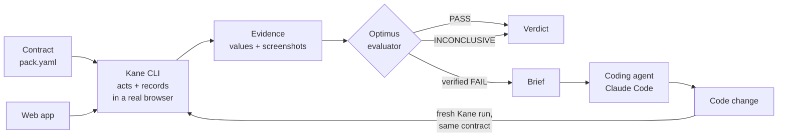

# Optimus

**One contract. Many different builds. Evidence-backed verdicts.**

Optimus checks many independently built web apps against one behavioural contract, such as every
submission to the same assignment. **Kane CLI** acts in a real browser and records what it sees;
Optimus judges that evidence deterministically, with no AI deciding the verdict. When a build fails,
Optimus sends the verified failure to a coding agent (**Claude Code**, headless), then has Kane check
the fix against the unchanged contract.

**Judges, start here (no Kane account, no credits, about 2 minutes):**

1. `npm ci && npm test`: 198 offline tests (evaluator, Kane adapter, repair loop and its anti-cheat rules, report).
2. Open [`tests/fixtures/report-bundle/index.html`](tests/fixtures/report-bundle/index.html) in a browser: the real
   report for five builds and three repairs, built from recorded Kane evidence. Every verdict links to Kane's screenshots.
3. Read [`runs/repair-u/`](runs/repair-u/REPORT.md): a blind defect, the brief Claude Code received, its one-line fix,
   and the fresh Kane run that proved it.

**[Live site](https://optimus-one-mu.vercel.app)** ·
**[Example report](https://optimus-one-mu.vercel.app/report/)** ·
**[Five-minute demo walkthrough](docs/DEMO.md)**

Built for the Kane CLI Online Hackathon (12–26 Nov 2026); see [BUILT_DURING_EVENT.md](BUILT_DURING_EVENT.md).

## What Kane caught

These are real runs, committed with their evidence in `runs/`:

| Build | What Kane recorded | Verdict | Repair (Claude Code) | Kane re-run |
|---|---|---|---|---|
| **U** — blind build, defect sealed until grading | after a reload, the list showed `none` instead of the book just added | FAIL (L4 persist) | one line: `saveBooks();` | PASS, all scenarios |
| **C** — removes the wrong book | removing "GP Alpha" removed "GP Beta" instead | FAIL (L3 remove) | one fix in `app.js` | PASS, all scenarios |
| **D** — loses books on reload | the list was empty after a reload | FAIL (L4 persist) | added persistence | PASS, all scenarios |
| **A**, **B** — vanilla JS and React | add, remove and persist all as required | PASS | — | — |

Calibration before any of this: 24 of 24 cases matched their expected verdicts, with zero replays.

Across all 97 archived runs, Kane reported a green run 11 times on a build that was actually broken;
Optimus caught each one from what Kane recorded ([Kane's result next to Optimus's verdict](runs/kane-vs-optimus/REPORT.md)).
Two Kane CLI issues found along the way are reported upstream:
[#252](https://github.com/LambdaTest/kane-cli/issues/252) (a "reload" that never reloads, yet passes) and
[#253](https://github.com/LambdaTest/kane-cli/issues/253) (values recorded from the wrong site).

## Try it in two minutes (no Kane account needed)

```sh
npm ci
npm test                      # 198 tests: evaluator, Kane adapter, repair loop, report
```

Then open [`tests/fixtures/report-bundle/index.html`](tests/fixtures/report-bundle/index.html) in a
browser: the real comparison report for five builds and three repairs, rendered from recorded Kane
evidence. Live runs need a TestMu AI account and Kane CLI (see [Run a live browser evaluation](#4-run-a-live-browser-evaluation)).

## How it works



| Component | Responsibility |
|---|---|
| **Behavioural contract** | Defines the expected behaviour and assertions for each scenario. |
| **Kane CLI** | Operates the application in a real browser and records observations. |
| **Evidence archive** | Preserves recordings, screenshots, test definitions and run metadata. |
| **Optimus evaluator** | Checks evidence against the contract and returns a verdict. |
| **Coding agent** | Attempts to repair the application after a verified failure. |

### What makes Optimus different

- **Deterministic evaluation:** an LLM does not decide whether an application passes or fails.
- **Evidence-backed verdicts:** decisions are based on recorded observations, not assumptions about what happened.
- **Explicit uncertainty:** missing or contradictory evidence produces `INCONCLUSIVE`, not an invented pass or fail.
- **Verified repair:** only a verified failure with no unresolved results can start a repair. Kane then reruns the full scope against the unchanged contract and grader.

## Current status

**23 November 2026**

| Validation | Result |
|---|---:|
| Gate 1 calibration (Library v5) | **24/24 cases matched** |
| Gate 2 reference-app cases | **4/4 matched** |
| Completed live repairs | **3** |
| Automated tests | **198 passing** |

Gate 2 currently covers reference apps and does not yet have a negative control. The three completed live repairs include a blind application whose defect remained sealed until grading.

**Reports and evidence**
- [Gate 1 v5 calibration](runs/gate1-v5/REPORT.md)
- [Gate 2 v5 results](runs/gate2-v5/REPORT.md)
- [Repair C — wrong book removed](runs/repair-c/REPORT.md)
- [Repair D — persistence failure](runs/repair-d/REPORT.md)
- [Repair U — blind repair](runs/repair-u/REPORT.md)

For a guided walkthrough, see [the five-minute demo](docs/DEMO.md).

## Getting started

### Requirements

- Node.js 22 for development
- npm

### Install and run checks

```sh
npm ci
npm run typecheck
npm test
```

The core development and offline evaluation workflows do not require Kane or TestMu AI credits. The offline CLI also runs on Node.js 18 with:

```sh
npm ci --omit=dev
```

## CLI workflows

All commands below are run from the repository root through the npm script.

### 1. Generate scenario instructions

```sh
npm run optimus -- gen-tests --pack packs/library --nonce demo --scenario L1
```

Omit `--scenario` to generate all four Library scenarios. Gate 1 uses L1, L3 and L4; L2 is reserved for Gate 2.

### 2. Lint generated instructions

```sh
npm run optimus -- lint .optimus/generated/library/demo/L1_test.md --pack packs/library --nonce demo
```

Lint checks the instructions and compares them with the generated Markdown for the same pack and nonce.

### 3. Evaluate evidence offline

```sh
npm run optimus -- evaluate trace.json --pack packs/library
```

The evaluator accepts a normalized `ScenarioTrace` JSON object or an array of scenario traces for one app URL and nonce. The trace schema is defined in [src/core/types.ts](src/core/types.ts).

An array produces a score from 0 to 1 when every scenario in the loaded pack has a PASS or FAIL verdict. A single trace returns its scenario verdict. The offline command expects trusted trace JSON and validates the referenced evidence archive structure.

### 4. Run a live browser evaluation

Install Kane CLI (`npm install -g @testmuai/kane-cli`, or set `OPTIMUS_KANE_CLI` to its `kane-cli.cjs` entry file), sign in to your TestMu AI account with it, and leave its Chrome profile unset. Start a corpus app on a loopback URL and select a scenario explicitly for a Gate 1 run.

```sh
npm run optimus -- run --pack packs/library --url http://127.0.0.1:3000/ --scenario L3
```

Optimus runs Kane in author mode and evaluates scenarios sequentially. Live Kane runs upload to TestMu and consume credits. The command prints the run directory and writes `result.json` and `report.html` there. Generated authoring inputs, raw streams and evidence stay in the ignored `.optimus/runs/` directory.

A selected scenario returns its own verdict exit code; the whole-pack score remains provisional.

## Automated repair loop

The repair command closes the loop between Kane, Optimus and a coding agent for a static application folder.

```sh
npm run optimus -- repair --pack packs/library --app corpus/c-remove-wrong --scenarios L1,L3,L4
```

The loop works as follows:

1. The app is copied into a disposable Git workspace outside the Optimus folder and served on a random loopback port.
2. Kane runs every scenario in scope. Optimus evaluates the evidence.
3. The decision gate considers the results. Only a verified FAIL with nothing unresolved starts a repair. INCONCLUSIVE stops for review.
4. The agent receives a brief containing the failed requirement, expected and observed values, and the failing step's screenshot. It does not receive the behavioral pack.
5. By default, the agent is Claude Code in headless mode, limited to file tools in the workspace. Use `--agent <path>` for another agent that reads the brief from stdin.
6. Optimus commits the agent's change, records the diff, and checks that the pack and grader sources (`src/core`, `src/kane`) remain unchanged.
7. Kane reruns the entire scope with a new nonce. The loop repeats until all scenarios pass or a safety cap is reached.

While it runs, the command prints timestamped progress to stderr: each Kane run starting and finishing (time and credits), Optimus's verdicts for that run, each decision, the brief, the agent's change and the integrity checks, with a heartbeat every minute. Stdout stays a single JSON summary for scripts.

Default caps are 3 attempts, 1,500 credits (including void attempts), and 20 minutes from the first agent call. Each session records its baseline, decisions, brief, agent invocation, source revisions, diff, integrity checks and verification run in `.optimus/repair/<session>/repair-history.json`.

### What the repair agent cannot do

Each rule is proved by a test in [`tests/loop.test.ts`](tests/loop.test.ts) that uses a fake agent which
cheats on purpose, against a throwaway copy of the contract and grader (never the real `packs/` or `src/`).

| The agent cannot… | What happens | Test |
|---|---|---|
| Edit the contract (`pack.yaml`) | STOP with an integrity failure; no verification run | `stops when the agent edits the pack file` |
| Edit the evaluator (`src/core/evaluate.ts`) | STOP; the file is listed in the attempt's integrity record | `stops when the agent edits src/core/evaluate.ts` |
| Edit the Kane adapter (`src/kane/`) | STOP; the file is listed in the integrity record | `stops when the agent edits a file in src/kane` |
| Add a file to the grader (`src/core/`) | STOP; the new file is listed in the integrity record | `stops when the agent adds a new file under src/core` |
| Learn where the contract is | The brief has no pack path, file name, hash or grader path | `never tells the agent where the contract is or what it is called` |
| See the contract or the other checks | The brief states only the one failed requirement | `never carries the contract, other assertions or grader vocabulary` |
| Work inside the Optimus folder | The workspace is refused | `refuses a repair workspace inside the Optimus folder` |
| Use a shell, the web or sub-agents (Claude Code) | Only Read, Edit, Write, Glob and Grep are allowed | `gives the default agent (Claude Code) file tools only` |
| Be started without a verified FAIL | No agent call when evidence is unresolved | `never calls the agent when the evidence is unresolved` |
| Claim a fix without changing the app | STOP | `stops when the agent changes nothing` |
| Grade its own fix | A fresh Kane run of every scenario in scope, with a new nonce | `repairs a verified failure and verifies it with a fresh full-scope run` |
| Keep trying forever | STOP at the attempt, credit or time cap | `stops at the attempt cap without changing anything else` |

The cheats are caught by comparing hashes before and after the agent runs, so the loop detects them; it does not
prevent them. An agent given a shell could still read the pack, and an agent wired in with `--agent` runs with your
own permissions. The integrity check catches any change, and the verdict still comes only from a fresh Kane run.

## Project structure

```text
Optimus/
├── packs/       Behavioural contracts and scenarios
├── src/
│   ├── core/    Contract loading, generation, linting and evaluation
│   ├── kane/    Browser-run adapter and evidence extraction
│   ├── loop/    Repair decisions, workspaces, agent and verification loop
│   ├── report/  Report data and the offline HTML report
│   └── cli.ts   Command-line interface
├── website/     The public site (Next.js static export), rendered from the same report data
├── corpus/      Reference and intentionally defective applications
├── runs/        Committed, sanitised run reports and repair records
├── tests/       Automated tests and fixtures
├── docs/        User-facing and engineering documentation
├── AGENTS.md    Rules every coding agent on this repo follows (Claude Code reads it via CLAUDE.md)
└── README.md
```

## Documentation

| Document | What it covers |
|---|---|
| [Demo walkthrough](docs/DEMO.md) | A guided five-minute demonstration of evaluation and repair. |
| [UI data contract](docs/UI_DATA_CONTRACT.md) | Data contract consumed by the report UI. |
| [UI structure](docs/UI_STRUCTURE.md) | Report interface organisation. |
| [Report design rules](DESIGN.md) | How the offline report looks and why. |
| [Agent instructions](AGENTS.md) | Repository rules for coding agents: Kane never judges, the contract never changes to suit an app. |

## Evaluation details

The evaluator distinguishes a failed requirement from insufficient or inconsistent evidence. A failed prerequisite makes a scenario INCONCLUSIVE. For steps that expect a change, recordings are paired with earlier values using an explicit delta source, matching before/after keys, or matching recording prompts. List order alone does not prove a membership change.

For list recordings, newly appearing entries must be authorized by the step's `new_values` declaration and appear in double quotes in that step's `do` text. Other quoted text does not authorize a new list entry. Inconsistent recordings produce `recording_inconsistent` and an INCONCLUSIVE result. Evidence paths are resolved relative to the trace file; step indexes and `stepsSkipped` entries are zero-based.

CLI exit codes:

| Code | Meaning |
|---:|---|
| `0` | PASS |
| `10` | FAIL |
| `20` | Unresolved result |
| `30` | Infrastructure or input failure |
| `40` | Repair loop stopped (including budget escalation) |

Actions default to `open` for the first step and `interact` for later steps. Packs may explicitly declare `action: reload` or `action: none`. Count deltas require nonnegative whole numbers. The Kane adapter joins author events to archived steps and links refreshes to the corresponding inner run.

## Library contract versions

Library contract **v5** is the current calibrated pack.

| Version | SHA-256 | History |
|---|---|---|
| v2 | `259613c83f6ff13aa3b3bb832092c214cc4fefbdfbc3cabaaa636882e63a1c80` | Phase 1 and the first six Gate 1 cases. A byte-identical fixture is kept at `tests/fixtures/library-v2.pack.yaml`. |
| v3 | `76f8bbdc4b1250f97105c600f20bfae26381721a1829e9539aadf4a82e1d6990` | Clarified title-only recording prompts after a React table layout caused authors to be recorded as titles. Superseded before a judged run. |
| v4 | `4ad9bb6e33c57d1718393452b16b0178f830e3805b43de8380fc4d26da2ab4f9` | Added explicit `new_values` for add steps. Gate 1 stopped after 6 of 24 cases when a keyboard shortcut did not trigger a real browser refresh. |
| v5 | `b5295a39f4bec78aacd7f071022cf50d881e9233a1271dddb423c6ddf0c2fc74` | Current pack. Changes the L4 reload instruction to require the browser's refresh action rather than a keyboard shortcut. Gate 1 restarted and completed at 24/24. |

Results from different contract versions are separate comparisons and are never mixed.

## License

This project is licensed under the [MIT License](LICENSE).
